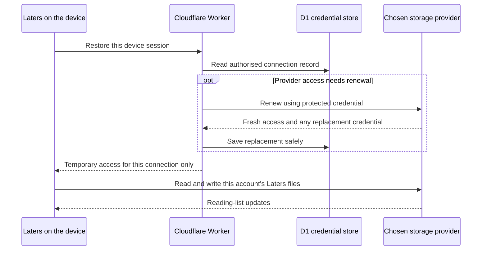

# Persistent sign-in and sync service

## Status and authority — 2026-11-08

The maintainer requested documentation and a plan for a free-tier sign-in service supporting
**Google Drive, Dropbox and OneDrive**, with an understandable privacy and security explanation.
The intended experience is **connect once on a device, then open Laters and sync automatically**.
Usability is a product requirement, not an experimental exception.

Authorised now: research, repository documentation and planning. On 2026-11-08 the maintainer
subsequently requested that all documentation be brought up to date, committed and pushed.
That authorises documentation delivery only. Application code, credential persistence,
provider-console changes, Cloudflare provisioning, service deployment, billing and a release
remain outside this authority. Implementation slices require separate agreement.
No service exists yet; the shipped application remains **1.6.3**, Google Drive only, with memory-only
access tokens and the [current Disconnect contract](google-account-switching-plan.md).

This plan owns the proposed architecture, cost boundary, sequence and acceptance criteria.
[Privacy and security](../sign-in-service-privacy-security.md) owns the data inventory, risks,
retention and operating requirements. Neither replaces the current public privacy policy.

## Product contract

- Optional connection; the local reading queue remains usable without an account or network.
- Choose one storage provider, use its normal sign-in/approval page, then return to that provider's
  own reading list. No separate Laters password, developer account, copied code or folder setup.
- Each device/browser profile establishes its own session. Later visits restore that session and
  renew access automatically. Expired/revoked permission or lost browser data can still need login.
- The provider/account namespace owns its articles and pending queue. Never identify or merge lists
  by matching email addresses. Supporting three providers does not connect or mirror all three.
- Preserve the current active-list boundaries for shares, CSV and chat add-links. Unknown accounts
  never inherit unassigned articles. Reuse existing Google associations and recovery exports.
- Connected actions remain **Sync now** and **Disconnect**. No Switch account button or adoption
  question. Disconnect, then Connect chooses a different provider/account.
- Disconnect stops automatic renewal and sync on this installation, including its other windows.
  It preserves local/cloud articles and other devices; provider-wide revocation is separate.
- The wider menu redesign is deferred. Provider selection and connection status need one bounded
  usability design before implementation, without reopening the accepted reading-tools layout.
- No promise of continuous OS background sync after closing a PWA. Persistent permission means
  Laters can sync when reopened; it does not make a closed browser execute work.

## Proposed architecture and flows

Cloudflare Workers Free is the candidate runtime. D1 Free would hold encrypted renewal credentials
and device-session records. Built-in Worker secrets would hold provider client secrets and a
separate encryption key. The static app can remain on GitHub Pages. Exact service hostname,
regional configuration and registrations are unprovisioned decisions.

The conversation's direct-sync diagram is a **token-mediating backend** proposal: the Worker
handles sign-in/renewal, but gives the browser a short-lived access token for direct provider calls.
The server never gives the browser the refresh token. Its proposed returning-visit flow is:

First connection: user starts Connect → Worker creates a short-lived, device-bound transaction →
provider displays account selection and permission → Worker validates the callback and exchanges
the code → records the scoped connection and sets a protected session cookie → app verifies the
account/list identity and loads only that list. User cancellation must retain the previous local list.
Tokens never appear in the return URL. An old callback cannot override a later Disconnect.

### Architecture decision still required

| Candidate | Browser receives | Worker handles | Trade-off to prove |
| --- | --- | --- | --- |
| Token-mediating service, as illustrated | Short-lived provider access token | Sign-in, renewal, device sessions | Fewer Worker requests and no normal article payloads there; malicious app code could steal temporary access. |
| Full backend for frontend (BFF) | Protected Laters session only | Sign-in, renewal and all allowed sync requests | Keeps provider tokens out of browser code; Worker processes article payloads and handles substantially more requests. |

[RFC 10017, section 6.2](https://www.rfc-editor.org/rfc/rfc10017.html#section-6.2) describes the
mediating pattern and strongly recommends assessing a full BFF first. This is not an assertion that
direct sync is the safest option. Slice 1 must compare both, measure their cost and explain the
actual constraint if choosing mediation. If mediation has no sufficient justification, prefer the
BFF. Neither option removes all browser attacks, and neither provides end-to-end encryption.

Keep any interface small and specific to sign-in, session restoration, renewal and Disconnect;
do not build a generic identity platform or arbitrary URL proxy. Final endpoint/schema design
follows the architecture choice, not this planning document.

## Provider setup and compatibility

The maintainer registers/configures each provider once. End users approve those registrations;
they do not create developer applications. Production permission/status must be checked on the
actual registration before public use. No real credential belongs in this repository.

| Provider | Proposed minimum access and setup | Evidence required before rollout |
| --- | --- | --- |
| Google Drive | Retain `drive.appdata`; use server authorisation-code/offline access. Preserve the production project's existing hidden files and opaque connection identity. | First grant and later re-consent may return credentials differently. Never overwrite a saved refresh credential with an absent value. Prove the existing account opens its exact existing list; no new Cloud project or silent reseeding. |
| Dropbox | App Folder access; candidate scopes `files.metadata.read`, `files.content.read`, `files.content.write`; request offline access. Add identity scope only if demonstrated necessary. | Validate account identity without gratuitous profile collection; create/read the account's folder and handle revision conflicts. Production review is triggered as usage grows: current guidance specifies the 50-user/two-week review window. |
| OneDrive | Delegated `Files.ReadWrite.AppFolder` plus `offline_access`; validate the minimum identity claims/permissions needed to bind the account. | Use the server web flow, not the SPA refresh-token lifetime. Personal accounts are the first acceptance target; work/school support needs explicit tenant-consent testing and may be restricted by administrators. No automatic broader file permission. |

Sources: [Google server flow](https://developers.google.com/identity/protocols/oauth2/web-server),
[Dropbox OAuth](https://developers.dropbox.com/oauth-guide),
[Dropbox production guide](https://www.dropbox.com/developers/reference/developer-guide),
[OneDrive app folder](https://learn.microsoft.com/en-us/graph/onedrive-sharepoint-appfolder),
[Microsoft refresh rules](https://learn.microsoft.com/en-us/entra/identity-platform/refresh-tokens).
Source facts were checked on 2026-11-08; recheck before provider setup.

Server support for a provider is not a file-sync adapter. Dropbox and OneDrive still need bounded
implementations of checkpoint/operation discovery, conditional writes, retries and housekeeping.
Preserve existing deterministic merge/delete/Undo rules, input limits and add-only import behaviour.
Do not assume Drive file IDs, search semantics or batching translate directly to another API.

## Strict free-tier boundary

Proposed infrastructure budget: **£0 recurring service spend** on Workers Free and D1 Free.
No paid plan, automatic paid upgrade, paid add-on, purchased monitoring, premium key service,
external identity subscription or paid storage is authorised. Existing domain ownership is assumed;
new domain purchase is outside this plan. Free hosting does not eliminate maintenance work.

Current published allowances, checked 2026-11-08:

| Resource | Free allowance / constraint |
| --- | --- |
| Worker | 100,000 requests/day shared across the account; 10 ms CPU per invocation. Waiting on network is distinct from CPU time. |
| D1 | 5 million rows read/day, 100,000 rows written/day, 5 GB total storage; other per-database limits also apply. |
| Exhaustion | Worker requests or database operations fail at the applicable limit. No silent fall-through of an authentication route. |

Sources: [Worker pricing](https://developers.cloudflare.com/workers/platform/pricing/),
[Worker limits](https://developers.cloudflare.com/workers/platform/limits/),
[D1 pricing and exhaustion](https://developers.cloudflare.com/d1/platform/pricing/).

These are ceilings, not an estimate of supported users. An existing paid account or other Workers
can change the budget boundary; confirm the actual account/plan before provisioning. Never assume
a spending alert is a hard cap. Recheck all selected features for free availability.

For an illustrative load comparison only, 100 installations open for 8 hours with one broker call
per hour would make about 800 renewal calls/day, before launches and callbacks. Routing just one
20-second sync poll per installation through a BFF would make 144,000 requests/day, before the
multiple file requests a poll may need. These are assumptions, not measured capacity. Polling,
change cursors, active hours and batching must be measured for both architectures; don't weaken
security just to meet an invented user target. Include shared-account usage and abusive traffic.

Measure CPU for crypto/provider libraries, reads/writes per renewal, burst load and cleanup.
Use indexed lookups, a single in-flight renewal per connection, bounded retries and coarse activity
updates; avoid a database write on every poll. Use bounded cleanup that works under free limits.
At quota/outage: retain local data and queues, stop retry storms, show **Sync temporarily unavailable**
and recover when service returns. A service error must not be treated as sign-out or delete a grant.

Provider API/storage limits are separate. [Google's current usage policy](https://developers.google.com/workspace/drive/api/guides/limits)
documents no additional cost for standard use and planned higher-usage billing changes. Recheck
provider quotas/billing, use the agreed no-spend controls and retain the existing no-billing Google
boundary. No unlimited/free-forever claim is permitted. If a safe usable design cannot fit Free,
stop with measured evidence and alternatives; do not activate payment or ship a broken promise.

## Journey acceptance

| State / trigger | Required result |
| --- | --- |
| Never connected, or session ended | Connect only; no premature Disconnect. |
| Initial sign-in / loading selected list | Clear Connecting… / Syncing… progress; cancellation/failure preserves the current local list. |
| Reopen with valid persistent session | Restore automatically, sync and show Sync now / Disconnect. No daily consent or extra list question. |
| Routine token expiry | Renew automatically; ordinary Syncing… remains understandable. |
| Provider rejects renewal | Preserve local changes, explain **Sign in again to continue syncing**, offer the normal Connect action. |
| Offline / broker outage / quota limit | Local list remains usable; retain pending changes; status distinguishes network/service failure from permission loss. |
| Disconnect while syncing | Stop local work immediately; invalidate this device session and prevent late renewal/callback resurrection. Other devices continue. |
| A → Disconnect → B → Disconnect → A | Each account restores only its own articles and pending queue, including across different providers. |

A remembered account name is not proof of a device session. A previously confirmed, unexpired
persistent-session receipt may support offline connection status/Disconnect; it is a display hint,
never server authorisation. First restore and offline/reopened states require explicit usability
review. [Privacy and security](../sign-in-service-privacy-security.md#disconnect-deletion-and-offline-use)
defines the limits of offline session invalidation and still-valid temporary tokens.

## Delivery slices — proposed, not started

| Slice | Bounded outcome | Evidence needed to move on |
| --- | --- | --- |
| 1. Architecture and privacy decision | Compare mediation/BFF, select origin/cookie arrangement, session/retention policy and free account boundary. Map scopes and existing Google migration. | Short decision receipt with measured/planned load, risk acceptance, and owner agreement to persistence and the privacy change. No production resources in this slice unless separately authorised. |
| 2. Isolated common connection flow | After implementation approval, local Worker/D1 simulation with fictional grants: Connect, callback, restore, renewal, Disconnect, expiry and cleanup. | Targeted negative/session-isolation/race tests; CPU/load measurements within Free; no general-purpose auth framework or large harness. |
| 3. Dropbox private end-to-end | First new provider as requested: real approved test account, app-folder sync, reopening and renewal, then a separate device/profile and account round trip. | Exact folder/queue isolation, failure recovery, pending upload and delete/Undo evidence. Existing Google use preserved. Agreed provider setup/privacy notice before real processing. |
| 4. Google persistent connection | Replace deliberate reconnect for an opted-in installation using the same cloud list; retain the current static path until migration is proved. | Existing list/operation IDs preserved; repeated close/reopen, renewal, cancelled migration and two-device Disconnect pass. No hidden new-project migration. |
| 5. OneDrive | Add personal Microsoft account app-folder sync behind the same reviewed connection contract. | Independent save/reopen, conditional write/retry, two-account isolation; record managed-account support separately. |
| 6. Public delivery | Final provider approvals, privacy/support/incident readiness, normal Update and concise owner/device acceptance. | All required checks pass, reviewed public wording matches actual processing, free-tier failure behaviour proven. No tag/release without separate authority. |

Every delivered code slice advances its version under the working agreements. This document-only
work does not change **1.6.3**. Native Mac/Android applications, cross-provider migration,
end-to-end content encryption and the wider menu redesign remain separate work.

## Next decision

Review the linked privacy/security explanation and choose mediation versus BFF using slice 1's
evidence. Confirm the proposed retention/session defaults, processing-location limits and the
no-spend operating boundary before authorising implementation. Documentation is complete as a
planning baseline; no service, credential, provider configuration or protection is implemented.
